# CNA School Simulator

A living, walkable 3D school built on [CNA](../cna) (a C++ reimplementation of XNA 4.0). Six levels, four
wings around a courtyard, a sports block and a community block, 748 rooms, 855 doors, ten staircases, an
outdoor campus with a running track, playground and car park, and up to a few thousand simulated people
who follow a bell schedule: lessons, breaks, lunch waves, clubs, fire drills.

The player walks through it in first person while the school day runs at any speed. The project is at the
same time a CNA 3D showcase, an integration and stress test, and a large-scale NPC / pathfinding /
scheduling experiment.

## Pictures

| | | |
|---|---|---|
| 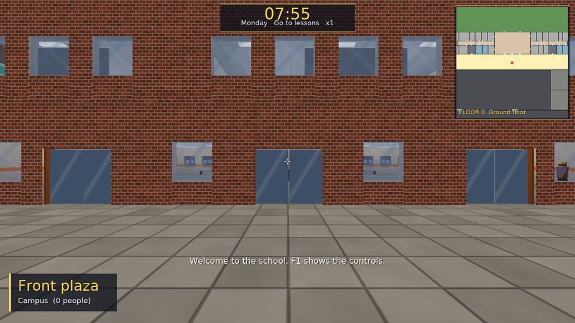 The main entrance at 07:55 | 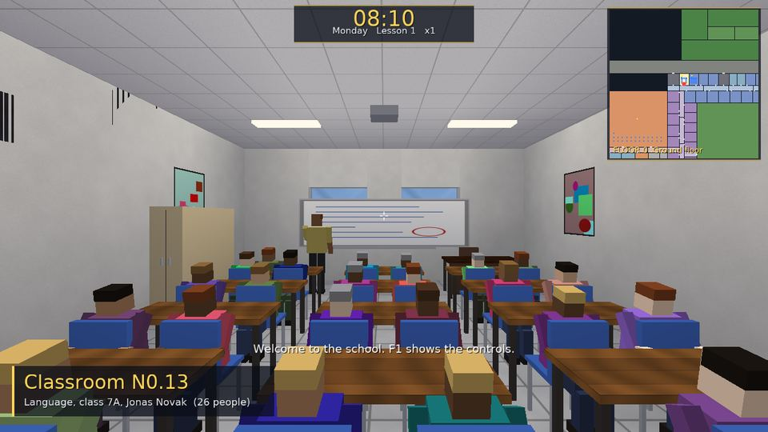 A lesson in progress | 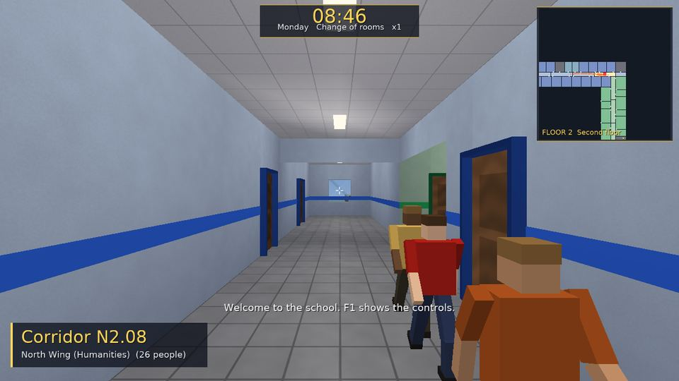 A corridor between lessons |
| 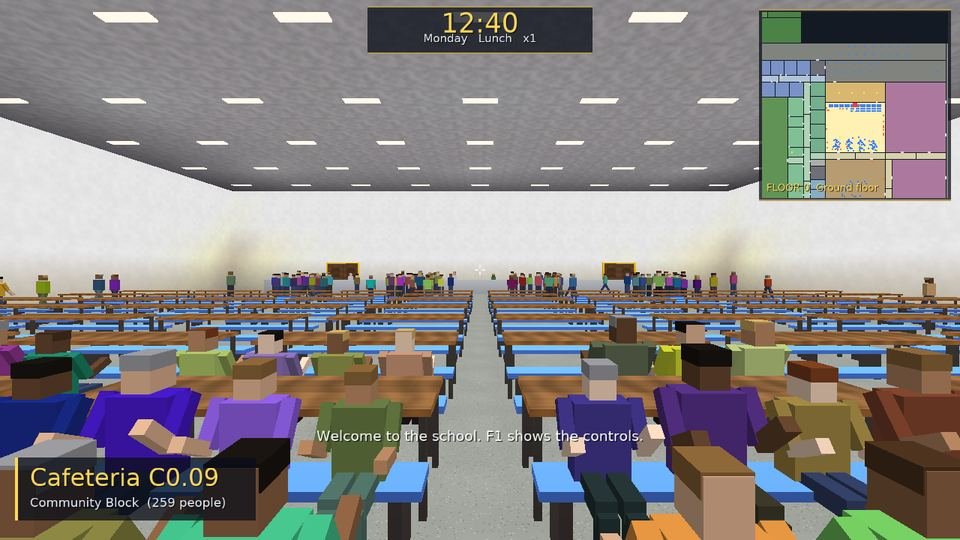 Lunch, first wave | 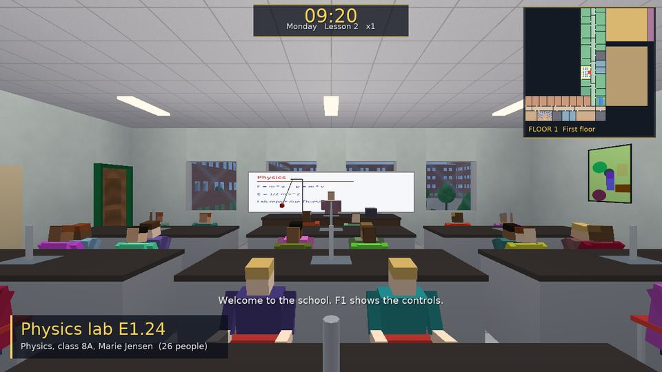 Physics: pendulum and board | 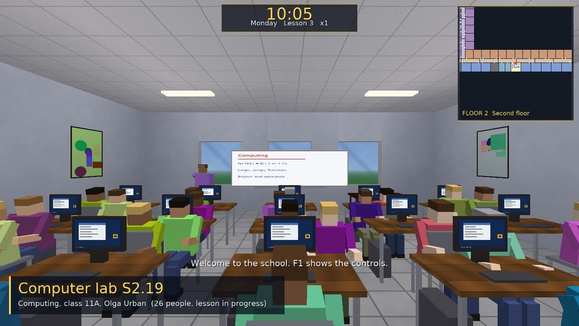 Computer lab with live desktops |
| 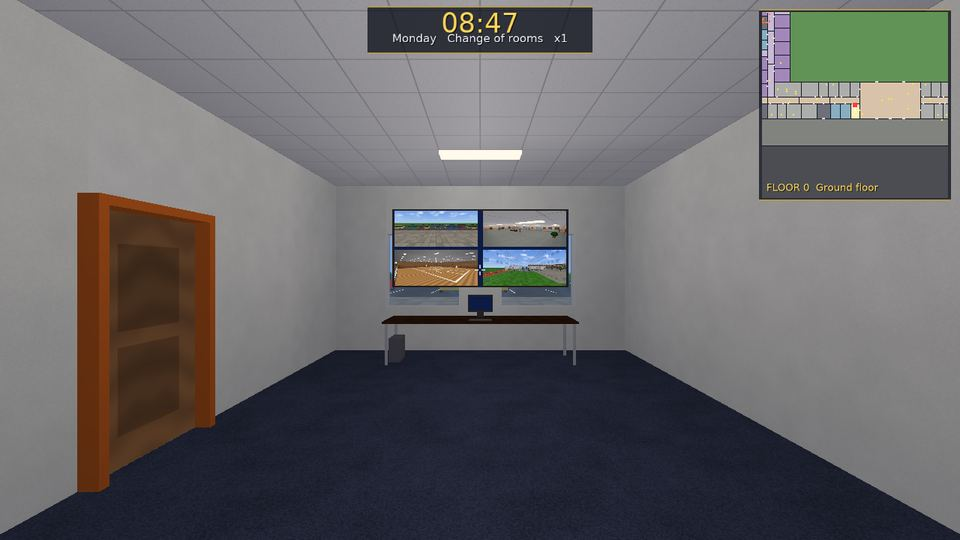 The security office's CCTV wall | 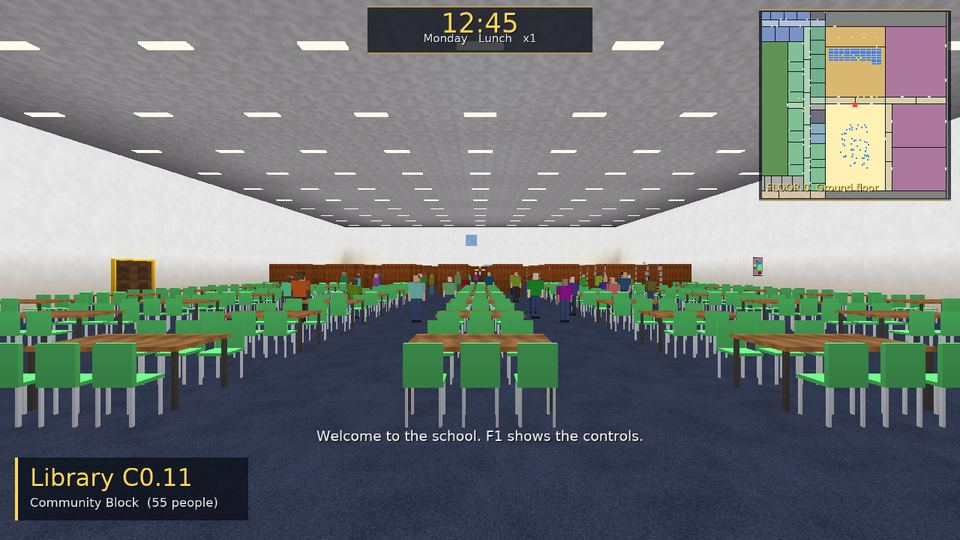 The library | 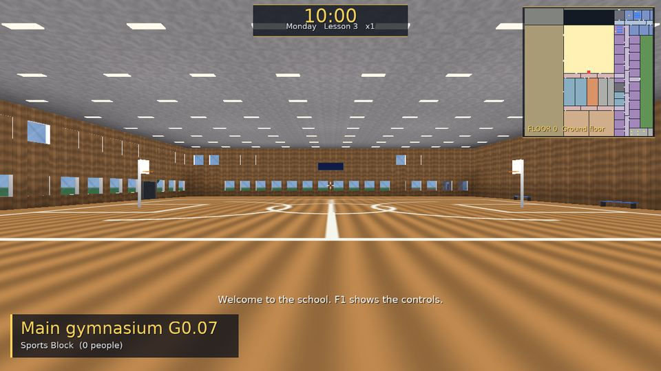 The gymnasium |
| 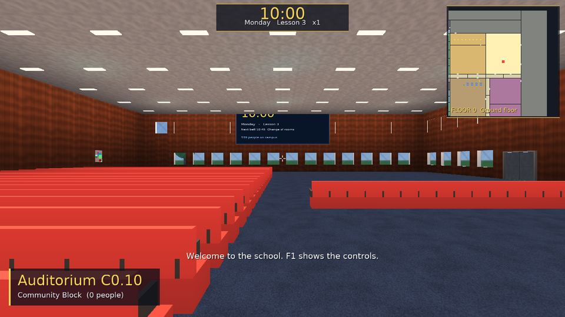 The auditorium | 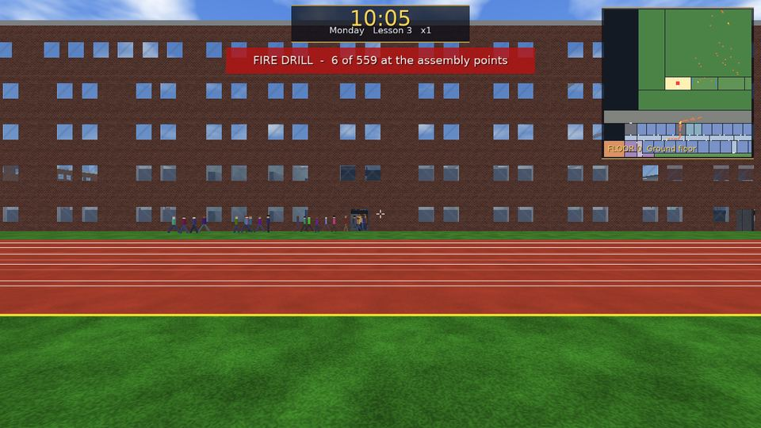 Fire drill: walking to the assembly points | 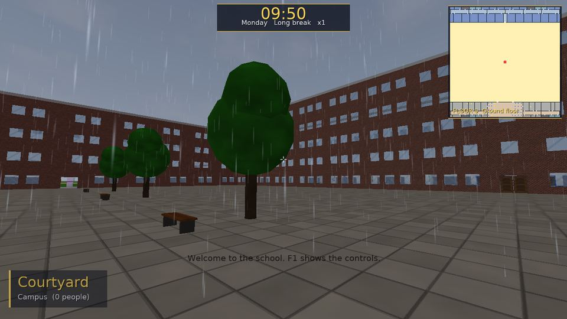 Rain in the courtyard |
| 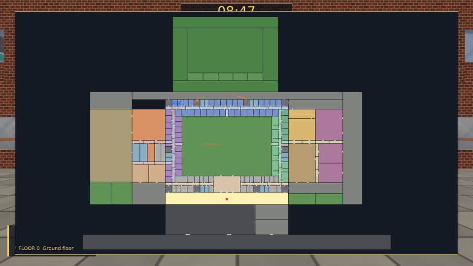 The campus map | 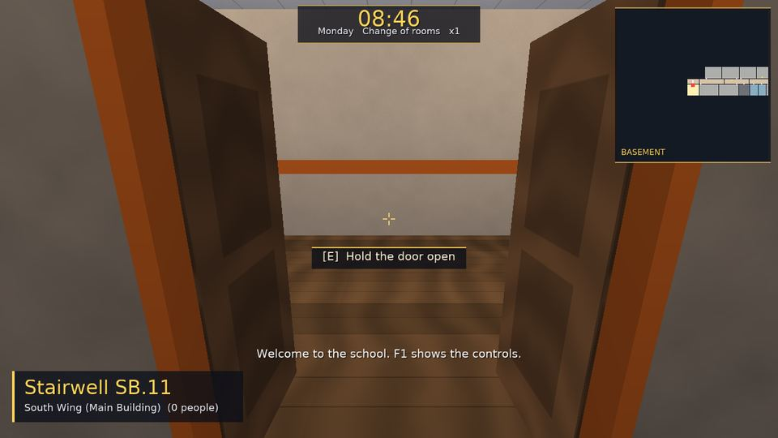 A stairwell at the bell | 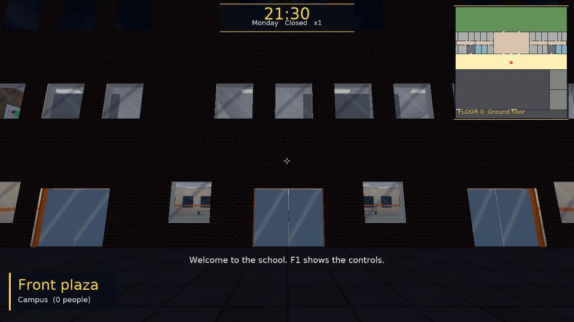 The entrance at night |

## What is there

| Area | Highlights |
|---|---|
| School | North (humanities), East (science), South (administration, arts, computing), West (languages, mathematics) wings on 6 levels with ten staircases and two elevators; sports block (gym, changing rooms, workshops); community block (cafeteria, kitchen, auditorium, library, music hall, drama studio); basement (lockers, boiler, servers, archive); campus (courtyard, plazas, playground, track, football field, car park, bicycle area, assembly points) |
| Rooms | 40 room types, each with its own furniture and the places people occupy: desks and chairs, lab benches, computer desks with monitors, easels, a piano, shelves full of books, theatre seats, a stage, serving counter and queue lanes, lockers, server racks, beds, hoops and scoreboards |
| People | students in classes with a weekly timetable, teachers, reception, admin, nurse, counsellor, IT, security, cooks, librarians, janitors; population presets from empty to extreme (2400 students) |
| Simulation | event-driven at three fidelity levels (abstract / reduced / full), hierarchical navigation (room graph plus waypoints, aisles inside rooms, stairs, elevator rides for those who prefer the lift), door gates with throughput, elevator cabs with calls, capacity and boarding, lane walking, local separation, stuck detection, lunch waves, after-school clubs, patrols, fire drills with assembly points; deterministic from a seed |
| Rendering | room interiors built lazily around the player, facade and roofs, animated door leaves and elevator cabs, box-figure people with poses and a walk cycle, day and night sky, fog, rain and snow, CCTV wall rendered into render targets, digital signage, whiteboards showing the lesson in progress, room code plates at every door, diagnostics monitors in the server room, animated demonstrations in the labs, workshops and gym |
| Audio | bells, alarm, doors, footsteps, room ambiences that follow occupancy, corridor chatter that follows the crowd around you, PA announcements, rain |
| UI | clock and phase, room banners with the lesson and teacher, prompts, toasts, minimap and full campus map, F3 statistics, F4 debug overlays (paths and fidelity, bounds and navigation nodes, collision boxes) |
| Testing | 150 000+ checks in `school_tests` (plan, navigation, elevators, timetable, schedule, layouts, determinism, full vs abstract agreement, drills, six-day soak), 3.4 million in `school_app_tests` (geometry of every room, collision at every door), CTest days at normal and extreme population, a headless screenshot tour on three renderers |

## Build

Requirements: CMake 3.23+, a C++23 compiler, the CNA checkout next to this directory (`../cna`, with its
siblings `sharp-runtime`, `easy-gl`, `meta-gl`). Python is not needed: every texture, sound and font is
generated by `tools/gen_assets.py` / `tools/gen_font.py` and committed.

```bash
tools/build.sh                 # configures build/ on first use, builds cna-school-simulator (3 jobs)
tools/build.sh school_tests school-sim-cli
SCHOOL_RENDERERS="OPENGLES3;OPENGL33;SOFTWARE" RECONFIGURE=1 tools/build.sh   # a multi-renderer tree
```

## Run

```bash
build/bin/cna-school-simulator                       # the front plaza at 07:50 on a Monday, normal population
build/bin/cna-school-simulator --preset busy --time 08:44 --room N1.05
build/bin/cna-school-simulator --weather rain --speed 5
build/bin/cna-school-simulator --help
```

Controls: `W A S D` walk, mouse look, `Shift` run, `E` / click use, `Esc` pause, `F1` help, `F3` statistics,
`F4` debug overlays, `Tab` map, `M` minimap, `Space` stop the clock, `1`..`5` time x1 x2 x5 x10 x30, `N` next lesson,
`B` bell, `F` fire drill, `P` announcement, `O` weather, `,` `.` fifteen minutes back or on, `R` back to the entrance, `F11` fullscreen, `F2` mute.
Elevators: `E` on the call button beside the door, step in, `E` on the panel's up or down button.
A gamepad works too (left stick walk, right stick look, A use, Start pause, Y map).

Headless (no display): `xvfb-run -a -s "-screen 0 1280x720x24" build/bin/cna-school-simulator --no-audio --script "..."`.
The script language (`goto:`, `busiest:`, `time:`, `speed:`, `drill`, `shot:`, `stats`, `quit`, ...) is documented at
`SchoolGame::RunScript` in `src/App/SchoolGame.cpp`; `tools/tour.sh` uses it to photograph every key place.

## Headless simulation

```bash
build/bin/school-sim-cli --validate --stats --population   # plan, counts, timetable
build/bin/school-sim-cli --day --check                      # one day, invariants checked every second
build/bin/school-sim-cli --days 5 --preset extreme --check  # soak
build/bin/school-sim-cli --day --full --students 300        # full-fidelity walking around a focus point
```

`tools/check_all.sh` runs everything: build, tests, validation, days, the screenshot tour. `tools/soak.sh`
runs a school morning at x30 and checks memory and stuck people; `tools/determinism.sh` checks that two
fixed-step runs end in the same state and picture.

## Layout of the repository

```
src/World/        the plan: floors, wings, rooms, doors, stairs (Blueprint.cpp writes the school as compact programs)
src/Rooms/        furniture and occupiable spots per room type
src/Navigation/   room graph, routes, waypoints
src/Simulation/   schedule, population and timetable, the simulation itself
src/Testing/      the headless command line
src/App/          the CNA Game, options, services
src/Rendering/    room geometry, world renderer, people, sky, weather, screens, helpers
src/Scene/        player collision
src/Interaction/  camera, player controller, input, usable things
src/Audio/        AudioSystem (CNA SoundEffect/3D) and the school's soundscape
src/UI/           HUD, minimap, fonts
Content/          generated textures, sounds, fonts, the schedule file
tests/            school_tests
tools/            build, tour, check_all, asset generators
docs/             architecture, layout, simulation, schedule, renderer testing, known issues, CNA coverage
```

The simulation half (`school_sim`) never includes CNA and is unit-tested without a window; the application
half (`school_app`) renders it through CNA only (BasicEffect, vertex and index buffers, SpriteBatch, SpriteFont,
RenderTarget2D, SoundEffect, the input classes). See `docs/ARCHITECTURE.md`.

## License

MIT, see `LICENSE`. Fonts: DejaVu Sans (`Content/Fonts/LICENSE-DejaVu.txt`). Everything else is generated.
